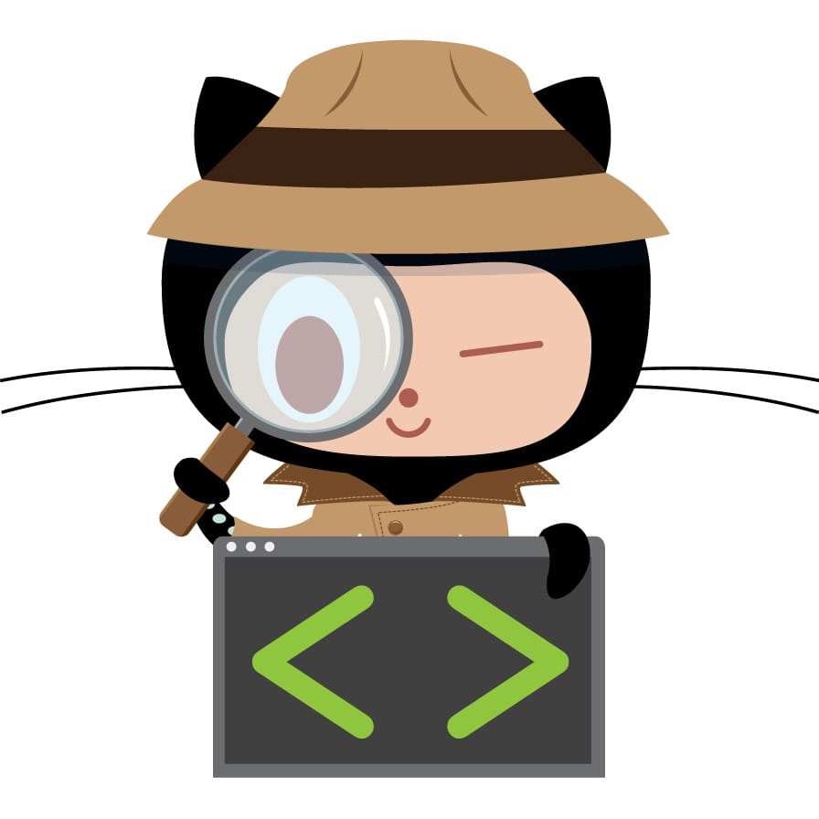

## Step 1: Checkout is crash-looping

It's 09:40 and your pager fires: **order-service pod restarts > 3 in 10m**. Customers of the pets store on Azure Kubernetes Service (AKS) can't check out.

You're on call. GitHub Copilot coaches this exercise; the Azure SRE Agent is a separate Azure service. The console shows seeded evidence and simulated outcomes, not live AKS telemetry or an actual agent execution.



### 📖 Theory: An SRE agent in Review mode

When an alert fires, [Azure SRE Agent](https://learn.microsoft.com/en-us/azure/sre-agent/overview) queries your observability stack (Azure Monitor, Application Insights, and Log Analytics) for correlated signals. It forms a root cause hypothesis, then suggests a mitigation or, when configured, runs one.

Whether it asks first depends on its [run mode](https://learn.microsoft.com/en-us/azure/sre-agent/run-modes):

| Mode | What happens | Best for |
| --- | --- | --- |
| **Review** | The agent proposes an action. A human approves or denies it. | Production systems, critical infrastructure |
| **Autonomous** | The agent runs the action and reports what it did. | Nonproduction environments, trusted recurring tasks |

The agent-level mode is a fallback. Incident response plans and scheduled tasks each default to **Autonomous**, so configure each explicitly. Run mode and Azure permissions are separate gates, and only an **SRE Agent Administrator** can approve. The current [run-modes page](https://learn.microsoft.com/en-us/azure/sre-agent/run-modes) documents Review and Autonomous; an older mitigation page mentions a conflicting ReadOnly mode. See the [Azure trial notes](https://github.com/{{ full_repo_name }}/blob/main/azure/README.md#enterprise-preflight).

The console displays seeded examples of signals an engineer might gather on AKS: KQL over [Container insights](https://learn.microsoft.com/en-us/azure/azure-monitor/containers/container-insights-log-query) tables such as `KubePodInventory`, `ContainerLogV2`, and `Perf`, plus `kubectl` output. No query or command runs against Azure.

### ⌨️ Activity: Open the SRE console

1. In the GitHub Copilot app, add this repository (`{{ full_repo_name }}`) and start a session on it.
1. Ask Copilot:

    > Open the Azure SRE console canvas.

    The console opens beside the chat. It loads from this repository's project extension in `.github/extensions/sre-console/`.

1. Select **Start shift**. Each incident is a round in a pet shop: customers queue until your fix passes verification. The score rewards evidence-backed decisions, not speed, and each failed verification costs points.

<details>
<summary>No Copilot app? Use the console in a browser 🌐</summary><br/>

From the repository root, in a Codespace or on your machine, run:

```bash
python3 -m http.server 8000 --bind 127.0.0.1
```

Open `http://localhost:8000/console/`. You run every step yourself, and **Download debrief** replaces **Save debrief to incidents/**. Upload the file to `incidents/` on `main` with **Add file → Upload files**.

</details>

### ⌨️ Activity: Work the incident

1. **Investigate.** Reveal every required seeded signal so the evidence explains the alert. You can click them, or ask Copilot to summarize them:

    > Coach me through the open simulated incident. Help me gather the required evidence, but don't name a cause until we have enough signals.

1. **Diagnose.** Pick the root cause that explains _every_ symptom, not just the loudest one.
1. **Propose and review.** Ask Copilot to propose a mitigation:

    > Propose a mitigation in the SRE console and explain how it matches the evidence. Do not approve it.

1. **Approve or deny.** Read the command, blast radius, and expected outcome; check the plan-review box. Deny a bad plan, or enter your GitHub handle (`{{ login }}`) and select **Approve plan**.
1. **Apply and verify.** Select **Apply in simulation**, then **Run simulated verification**. This changes game state only. If verification fails, re-triage and choose another plan; new evidence or a changed diagnosis invalidates the old approval.
1. **Debrief.** Add a note and save the report. It must include required evidence, the correct diagnosis, an approved mitigation, and successful simulated verification.
1. Ask Copilot to ship it:

    > Commit incidents/oom-killed.md and push it to main.

1. Wait about 20 seconds and refresh this issue. A results table appears, and the next step follows once every check passes.

<details>
<summary>Having trouble? 🤷</summary><br/>

- If the canvas doesn't appear, start a fresh Copilot App session with this repository as its workspace.
- Diagnose stays locked until all required signal samples are revealed. A new signal or changed diagnosis clears the previous plan and approval.
- Restarting or scaling out doesn't help a pod that is killed for exceeding its memory limit. Look at the exit code and the memory chart.
- If a check fails, fix the incident in the console, save again, and push the updated report.
- Pushed a later incident's report early? Each step grades it as soon as the previous step passes. To rerun a check yourself, open the **Actions** tab, select the step's workflow, and choose **Run workflow**.

</details>
