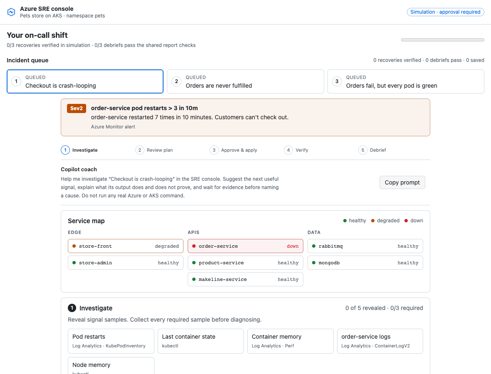

# Azure SRE Incident Response Game

_Work a queue of three simulated AKS incidents with GitHub Copilot as your coach. Investigate, diagnose, review a plan, make the approval decision yourself, apply the simulated change, verify, and debrief._

## Welcome

- **Who this is for**: Developers, SREs, and platform engineers learning evidence-led incident response and human approval controls.
- **What you'll learn**: How evidence supports a root cause, how [Azure SRE Agent Review mode](https://learn.microsoft.com/en-us/azure/sre-agent/run-modes) gates Azure infrastructure writes, and why approval and verification are separate.
- **What you'll build**: Three incident reports in `incidents/`, checked by the repository's shared grader and GitHub Actions.
- **Prerequisites**: The GitHub Copilot app for its canvas and coaching actions (or a browser for the static console), and basic Kubernetes vocabulary. The game needs no Azure subscription.
- **Time**: About 45 minutes.

The default experience is a **local simulation**: its signals, service health, mitigation effects, and verification are seeded exercise data—not live telemetry, an Azure SRE Agent execution, or an AKS cluster change. The optional executable lab uses Azure Container Apps (ACA), not AKS; it is a separate, billable track.



## Start the exercise

### Open the source preview in Copilot App

[](https://github.com/copilot/app/launch?open=ghapp%3A%2F%2Fsession%2Fnew%3Frepo%3Dragmha%252Fazure-sre-gh-project%26branch%3Dazure-sre-exercise%26mode%3Dinteractive%26prompt%3DOpen%2520the%2520Azure%2520SRE%2520console%2520canvas%2520and%2520coach%2520me%2520through%2520the%2520three%2520incident%2520simulations.%2520Use%2520simulated%2520evidence%2520only.%2520Never%2520approve%2520a%2520mitigation%2520for%2520me%252C%2520run%2520commands%2520against%2520Azure%2520or%2520AKS%252C%2520or%2520deploy%2520resources.%2520Guide%2520me%2520to%2520gather%2520evidence%252C%2520diagnose%252C%2520review%2520the%2520plan%252C%2520make%2520my%2520own%2520approval%2520decision%252C%2520apply%2520the%2520simulated%2520action%252C%2520verify%252C%2520and%2520debrief.)

This opens the unmerged `azure-sre-exercise` source branch as a preview. The [Copilot App deep-link launcher](https://docs.github.com/en/copilot/how-tos/github-copilot-app/open-with-deep-links) asks you to confirm starting the session; it does not deploy Azure resources. **Do not save or push graded reports to this source repository.**

### Copy Exercise (available after merge to `main`)

The GitHub template action copies from `main`, which still contains the original starter exercise. **Copy Exercise is not ready yet**; wait until the game implementation is merged to `main`. The source-branch preview above is the working path for now. After the merge, create your own copy and launch Copilot from that repository so your reports are graded there.

<details>
<summary>Having trouble?</summary>

- Choose your personal account or an organization as the owner.
- Public repositories can run Actions without using private-repository minutes.
- If setup does not finish, check the **Actions** tab in your copy.

</details>

## The on-call shift

Follow the same deliberate response loop for each incident:

1. **Investigate** — collect required seeded evidence about impact and scope.
2. **Diagnose** — choose the cause that explains the signals.
3. **Review and approve** — inspect the command, blast radius, and expected outcome; explicitly approve or deny the proposal yourself.
4. **Apply and verify** — apply the approved change in the simulation, then run a separate simulated verification. A failed verification can be retried; new evidence or a changed diagnosis clears the old plan and approval.
5. **Debrief** — record the incident report. Shared report checks require evidence, correct diagnosis, a human-approved mitigation, and the expected simulated verification. Commit the report to your copy's `main` branch for GitHub Actions to record the step.

Copilot can coach, investigate the seeded evidence, and propose a mitigation. It cannot approve for you. This is a learning control, not a security boundary.

## How it works

| Component | Location | Purpose |
| --- | --- | --- |
| Scenarios | `lab/scenarios.json` | Alerts, service health, seeded signals, root causes, mitigations, and Microsoft Learn sources. |
| Console | `console/` | Guided incident queue, staged response loop, simulation, and debrief. |
| Canvas extension | `.github/extensions/sre-console/` | Opens the console and provides `get_state`, `select_scenario`, `investigate`, `propose_mitigation`, and `get_progress`. It has no approve action. |
| Grader | `lab/check.mjs` | Checks `incidents/<scenario>.md`; the step workflows post results to the exercise issue. |

### Run the console without the Copilot app

```bash
python3 -m http.server 8000 --bind 127.0.0.1
```

Open `http://localhost:8000/console/`. Progress and downloaded debriefs stay in your browser; the static preview does not contact GitHub Actions.

### Develop

Node 22 or later:

```bash
node --test 'lab/*.test.mjs' '.github/extensions/sre-console/*.test.mjs'
node lab/check.mjs oom-killed   # grade a report locally
```

To change an incident, edit `lab/scenarios.json`. The tests check required evidence, a unique correct root cause, correct and tempting incorrect mitigations, and Microsoft Learn links. To check canvas discovery after changing the extension, start a fresh Copilot App session with this repository as its workspace.

The Azure track's prerequisites, role split, current SRE Agent limitations, costs, quota preflight, and scoped teardown are documented in [`azure/README.md`](azure/README.md). No Azure resources are deployed by this repository's GitHub Actions.

## Credits

The incident scenarios and pets-store setting are inspired by [matthansen0/azure-sre-agent-sandbox](https://github.com/matthansen0/azure-sre-agent-sandbox) (MIT). The game loop takes interaction inspiration from [crazy4pi314/mos-diner-game](https://github.com/crazy4pi314/mos-diner-game). The exercise structure follows [skills/exercise-template](https://github.com/skills/exercise-template) and [skills/exercise-toolkit](https://github.com/skills/exercise-toolkit).
